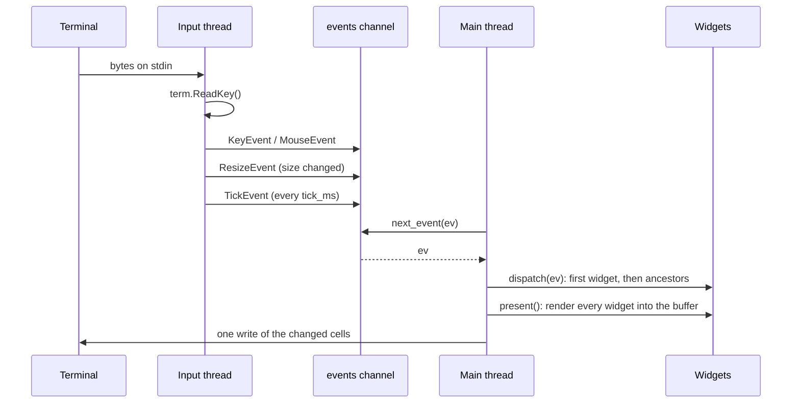

Exactly one part of basalam is asynchronous: reading input. Everything that touches your widgets runs synchronously on the main thread, one event at a time. That is why `handle_event` can be plain code with no locks and no `async`.

## Two threads, one channel



**The input thread** starts in `screen.start()`. It loops over three sources:

- **Keys and mouse.** It waits up to `PollMs` (20 ms) for input with `term.KeyReady`, then reads it with `term.ReadKey`. Keys become a `KeyEvent`. Mouse reports are decoded with `term.DecodeMouse` into a `MouseEvent`.
- **Size.** It checks `term.Size()` on every pass and sends a `ResizeEvent` when it changes. See [Limitations](#limitations) for why this polls.
- **Ticks.** When `tick_ms` is above zero, it sends a `TickEvent` that often. A late tick is scheduled from the time it was sent, so a slow main thread gets one late tick, not a burst of catch-up ticks.

The input thread never touches widgets, the tree, or the buffer. Its only shared state is the channel, which `std/chan` already synchronizes.

<Note>
  Key repeat is not a special event. Holding a key makes the terminal send the same bytes again and again, and each one becomes its own `KeyEvent` through the input loop. basalam coalesces nothing and drops nothing. Whether a repeat means "hold" or "one more step" is your application's decision.
</Note>

**The main thread** owns everything else. Each turn of the loop takes one event, dispatches it, and draws.

## The loop you write

```salam
screen.present()
mut ev := basalam.Event {}
until screen.next_event(ev):
    if not screen.dispatch(ev) and ev.is_char("q"):
        screen.stop()
    end
    screen.present()
end
```

- `next_event` blocks until an event arrives. It returns `false` when the screen was stopped and the queue is empty.
- `dispatch` handles a resize (the buffer is reallocated and the root refitted first, forcing a full repaint), then offers the event to a starting widget and [bubbles it up](/reference/event#dispatch-and-bubbling). The starting widget is the focused one, except for mouse events (see [Mouse routing](#mouse-routing)). It returns whether a widget consumed it.
- Anything no widget consumed is yours: keymaps, modes, and quitting are application decisions, not library ones.
- `present` draws every widget into the buffer and writes only the cells that changed since the last frame.

`run()` and `run_with_tick(on_tick)` are this loop with two additions: they redraw only when something changed (`screen.dirty`), and an unconsumed Ctrl+C stops them. In raw mode, Ctrl+C is an ordinary key, so without this a program that forgets to handle it could not be left.

## Stopping and restoring the terminal

`stop()` closes the channel. Events already queued are still delivered, then `next_event` returns `false`. The input thread notices the closed channel within `PollMs` and exits.

`close()` calls `stop()`, writes the sequences that show the cursor and leave the alternate screen, restores the saved terminal modes with `term.Restore`, joins the input thread, and frees the screen. Put it in a `defer` right after `start()`:

```salam
screen.start()
defer screen.close()
```

Every `ret` from that function, including early error returns, then restores the terminal.

## Resize

When the terminal size changes, the input thread sends a `ResizeEvent` with the new `width` and `height`. `dispatch` reallocates the buffer's two grids and gives the root widget the full rect before any widget sees the event; the next frame repaints in full. When the root is a [layout container](/reference/layout), that `set_bounds` call propagates down the tree, so a resize re-lays out every child in one pass. Hand-placed widgets keep their bounds; recompute those in your loop, as the demo does:

```salam
consumed := screen.dispatch(ev)
if ev.kind == basalam.ResizeEvent:
    arrange(screen, left, right) // your own layout function
end
```

<Note>
  A container root re-lays out the tree on resize: `fit_root` gives the root its new bounds through `set_bounds`, which recurses through the containers. Hand-placed widgets are still your loop's job.
</Note>

## Mouse routing

A key press belongs to whoever has the focus. A click belongs to whatever is under the cursor. So `dispatch` routes the two differently:

1. For a `MouseEvent`, the screen converts the report to a 0-based cell with `event.mouse_point()` and calls `hit_test(x, y)`.
2. `hit_test` returns the topmost widget whose bounds contain that cell. Topmost means painted last, which is the highest ID: a child beats its parent, and a later sibling beats an earlier one. It is always what the user sees on that cell.
3. The event starts at that widget and [bubbles up](/reference/event#dispatch-and-bubbling) through its ancestors.
4. If no widget contains the cell (a click outside the buffer, or a report that did not decode), the event starts at the focused widget, like every other event.

Every other event kind (keys, ticks, resizes) still starts at the focused widget.

<Note>
  Routing a click does not move the focus. Whether a click should focus the widget it hits is the widget's or the application's call: call `screen.focus(id)` from your own code when you want it.
</Note>

Mouse events only arrive when you set `screen.mouse = true` before `start()`.

## No key bindings

basalam delivers raw `KeyEvent`s and ships no bindings. There is no built-in `Tab` for focus, no `q` for quit, and no vim keys (`hjkl`, `gg`, `G`, `/`). The focus methods (`focus_next`, `focus_up`, and the rest) exist, but connecting them to keys is your job.

This is deliberate. Bindings are policy, and every application wants a different one. An application that wants vim-style modes wraps the library and interprets keys itself, the way Televim wraps ratatui. The library stays small, and nobody has to fight a default they cannot turn off. The [demo](https://github.com/curedbylethe/basalam/blob/main/examples/demo.salam) shows the usual shape: an application-owned function that maps keys to focus calls.

## Limitations

**Resize is polled, not signalled.** Terminals announce a resize with the `SIGWINCH` signal, and most TUI libraries listen for it. Salam's standard library has no signal API (no `sigaction`, no `SIGWINCH`), and basalam does not use FFI, so the input thread asks `term.Size()` on every pass instead.

- A resize reaches your widgets at most `PollMs` (20 ms) after it happens. That is below one frame at 30 fps, so it is not visible in practice.
- The cost is one size query per wake-up, whether or not anything changed.
- Lowering `PollMs` makes resizes snappier and `stop()` quicker, and spends more CPU while idle. Raising it does the opposite.
- Nothing about your code depends on this. A `ResizeEvent` looks the same however it was detected, so if Salam gains signal support only the input thread changes.
