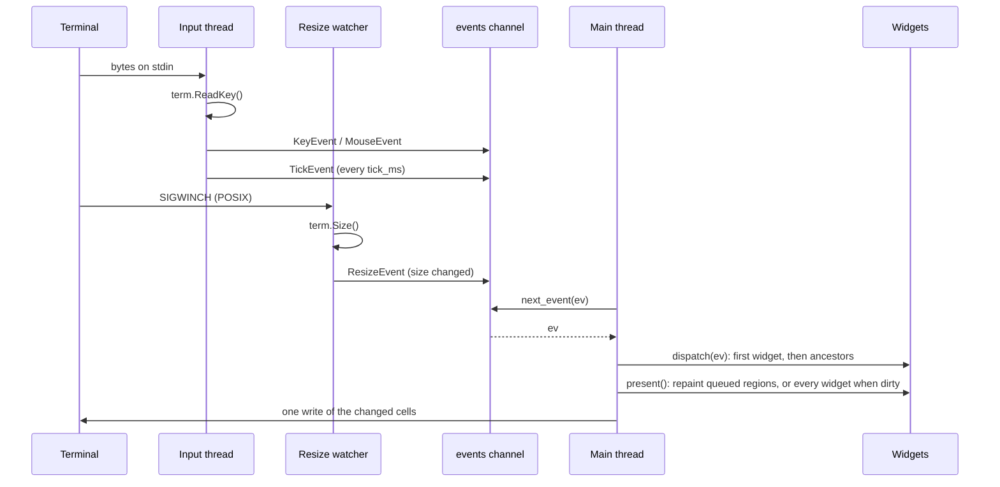

Exactly one part of basalam is asynchronous: input. Everything that touches your widgets runs synchronously on the main thread, one event at a time. That is why `handle_event` can be plain code with no locks and no `async`. On POSIX a second background thread feeds the same channel: the resize watcher described below.

## Background threads, one channel



**The input thread** starts in `screen.start()`. It loops over two sources:

- **Keys and mouse.** It waits up to `PollMs` (20 ms) for input with `term.KeyReady`, then reads it with `term.ReadKey`. Keys become a `KeyEvent`. Mouse reports are decoded with `term.DecodeMouse` into a `MouseEvent`. When reading returns `term.KeyEOF` (stdin ended, or stdin is not a terminal), the thread reports one `KeyEvent` and stops reading; the channel stays open and events already queued are still delivered.
- **Ticks.** When `tick_ms` is above zero, it sends a `TickEvent` that often. A late tick is scheduled from the time it was sent, so a slow main thread gets one late tick, not a burst of catch-up ticks.

**The resize watcher** (POSIX only) starts in `screen.start()` as well. Size is a signal, not input: the terminal announces a resize with `SIGWINCH`, so `start()` installs a handler and blocks the signal before spawning either thread. The watcher parks in `sigwait`, reads `term.Size()` on each wake, and sends a `ResizeEvent` only when the size actually changed, so a wake with an unchanged size emits nothing. Windows has no `SIGWINCH`: there the input thread keeps polling `term.Size()` once per pass, and `PollMs` bounds that poll. See [Limitations](#limitations).

The signal plumbing is exposed as `WinchSignal`, `WinchSupported`, `NewWinchSet`, `InstallWinchHandler`, `BlockWinch`, `WaitWinch`, and `WakeWinch`. They are public so `Screen` and the tests can install, block, wait on, and wake the watcher; they are not an application API.

Neither thread touches widgets, the tree, or the buffer. Their only shared state is the channel, which `std/chan` already synchronizes.

<Note>
  Key repeat is not a special event. Holding a key makes the terminal send the same bytes again and again, and each one becomes its own `KeyEvent` through the input loop. basalam coalesces nothing and drops nothing. Whether a repeat means "hold" or "one more step" is your application's decision.
</Note>

**The main thread** owns everything else. Each turn of the loop takes one event, dispatches it, and draws.

## The loop you write

```salam
screen.present()
mut ev := basalam.Event {}
until screen.next_event(ev):
    if not screen.dispatch(ev) and ev.is_char("q"):
        screen.stop()
    end
    screen.present()
end
```

- `next_event` blocks until an event arrives. It returns `false` when the screen was stopped and the queue is empty.
- `dispatch` handles a resize (the buffer is reallocated and the root refitted first, forcing a full repaint), then offers the event to a starting widget and [bubbles it up](/reference/event#dispatch-and-bubbling). The starting widget is the focused one, except for mouse events (see [Mouse routing](#mouse-routing)), and a click on an open [Modal](/reference/modal)'s scrim starts at the Modal. It returns whether a widget — or the [keymap](/reference/keymap) fallback — consumed it.
- An unconsumed `KeyEvent` is then offered to the screen's opt-in [keymap](/reference/keymap), if you installed one. Whatever is still left — quitting, modes — is yours: application decisions, not library ones.
- `present` returns immediately when nothing is pending. Otherwise it repaints the queued regions, or every widget when `dirty` is set, and writes only the cells that changed since the last frame. A change you make outside `dispatch` stays invisible until you set `dirty` or call `invalidate(id)` (or `invalidate_subtree(id)` for the widget and its descendants).

`run()` and `run_with_tick(on_tick)` call `present` only when `dirty` is set or a region is pending. An unconsumed Ctrl+C stops them. In raw mode, Ctrl+C is an ordinary key, so without this a program that forgets to handle it could not be left.

## Stopping and restoring the terminal

`stop()` closes the channel. Events already queued are still delivered, then `next_event` returns `false`. The input thread notices the closed channel within `PollMs` and exits. The resize watcher is parked in `sigwait` instead of polling, so `close()` wakes it with a self-signal and it exits as soon as it sees the closed channel.

`close()` calls `stop()`, writes the sequences that show the cursor and leave the alternate screen, restores the saved terminal modes with `term.Restore`, joins the input thread and the resize watcher, and frees the screen. Put it in a `defer` right after `start()`:

```salam
screen.start()
defer screen.close()
```

Every `ret` from that function, including early error returns, then restores the terminal.

## Resize

When the terminal size changes, a `ResizeEvent` arrives with the new `width` and `height` — from the resize watcher on POSIX, from the input thread on Windows. `dispatch` reallocates the buffer's two grids and gives the root widget the full rect before any widget sees the event; the next frame repaints in full. When the root is a [layout container](/reference/layout), that `set_bounds` call propagates down the tree, so a resize re-lays out every child in one pass. Hand-placed widgets keep their bounds; recompute those in your loop, as the demo does:

```salam
consumed := screen.dispatch(ev)
if ev.kind == basalam.ResizeEvent:
    arrange(screen, left, right) // your own layout function
end
```

<Note>
  A container root re-lays out the tree on resize: `fit_root` gives the root its new bounds through `set_bounds`, which recurses through the containers. Hand-placed widgets are still your loop's job.
</Note>

## Mouse routing

A key press belongs to whoever has the focus. A click belongs to whatever is under the cursor. So `dispatch` routes the two differently:

1. For a `MouseEvent`, the screen converts the report to a 0-based cell with `event.mouse_point()` and calls `hit_test(x, y)`.
2. `hit_test` returns the topmost widget whose bounds contain that cell, whose whole ancestor chain reports [`visible()`](/reference/widget#visible) true, and whose `hits()` is true. Topmost means last in paint order. Paint order is ascending `(stamp, id)`, and the scan walks it in reverse. With nothing raised, that is the highest ID, so a child beats its parent and a later sibling beats an earlier one. A raised widget beats every widget in an earlier layer. A widget that paints and returns `hits() == false` is skipped, and the scan continues under it. The winner is what you see on that cell only when the widget on top accepts hits. An open Modal accepts hits over its whole bounds, so its scrim catches clicks that would otherwise reach the widgets beneath it.
3. The event starts at that widget and [bubbles up](/reference/event#dispatch-and-bubbling) through its ancestors.
4. If no widget contains the cell, every widget on the cell refuses hits or is hidden, or the report did not decode, the event starts at the focused widget, like every other event.

Every other event kind (keys, ticks, resizes) still starts at the focused widget. An open Modal consumes Esc itself, so Esc closes it rather than reaching the keymap.

<Note>
  Routing a click does not move the focus. Whether a click should focus the widget it hits is the widget's or the application's call: call `screen.focus(id)` from your own code when you want it.
</Note>

Mouse events only arrive when you set `screen.mouse = true` before `start()`; set `screen.mouse_motion = true` instead to also receive movement reports, and it reports presses and releases too.

## Key bindings

basalam delivers raw `KeyEvent`s, so your widgets always see a key first. What a key means is policy, and policy belongs to the application, so the library imposes no bindings of its own: press nothing and nothing happens.

The extension point is the opt-in [keymap](/reference/keymap). Every screen holds a `Keymap`, empty by default. `dispatch` offers a `KeyEvent` to the widget chain first and passes it to the keymap only when no widget consumed it, so a widget's own handling always wins and the keymap fills the gaps. Non-key events never reach the keymap.

`NewDefaultKeymap()` supplies the library's only stock map: `Tab` moves to the next widget and the four arrows move spatially. Nothing installs it for you — opt in with `screen.set_keymap(basalam.NewDefaultKeymap())`, or build your own with `bind` and its variants. There is still no `q` for quit and no vim keys (`hjkl`, `gg`, `G`, `/`). The Esc handling of an open [Modal](/reference/modal) is widget-level, the same way a `Button` takes Enter, so it is not a keymap binding, and the keymap still has no bindings of its own.

Modes stay app-level. An application that wants vim-style modes wraps the library and installs the map that matches the current mode, the way Televim wraps ratatui. The library stays small, and nobody has to fight a default they cannot turn off. The [demo](https://github.com/curedbylethe/basalam/blob/main/examples/demo.salam) installs the default map before its loop; a custom binding is just as short:

```salam
// Opt in to the library defaults, then add a binding of your own.
screen.set_keymap(basalam.NewDefaultKeymap())
screen.keymap.bind(term.Decode("n"), (screen: basalam.Screen*, event: basalam.Event): ret screen[0].focus_next() end)
```

## Limitations

**How resize detection works.** On POSIX the terminal announces a resize with `SIGWINCH`. `start()` installs a handler and blocks the signal, and a dedicated resize watcher parks in `sigwait`, reads `term.Size()`, and sends a `ResizeEvent` only when the size changed. Windows has no `SIGWINCH`, so there the input thread keeps polling `term.Size()` once per pass.

- Rapid resizes coalesce: `SIGWINCH` does not queue, so two quick resizes can arrive as one wake and an intermediate size can be skipped. The event always carries the current size, so a container re-laid out to the final size is the right outcome.
- On Windows, a resize reaches your widgets at most `PollMs` (20 ms) after it happens. That is below one frame at 30 fps, so it is not visible in practice.
- Lowering `PollMs` makes `stop()` quicker and the Windows poll snappier, and spends more CPU while idle. Raising it does the opposite. On POSIX, resize latency does not depend on `PollMs`.
- Start the screen before your own threads. Call `screen.start()` before spawning threads of your own: a thread created earlier does not inherit the blocked `SIGWINCH`, so the kernel may deliver a resize to it, where the no-op handler swallows it. If you must create a thread first, block `SIGWINCH` in it yourself.
- Nothing about your code depends on this. A `ResizeEvent` looks the same however it was detected.
