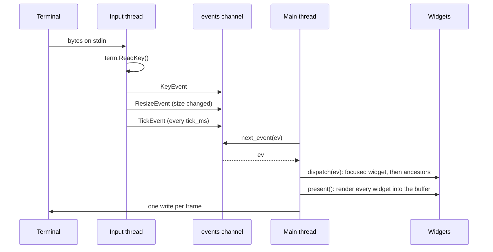

Exactly one part of basalam is asynchronous: reading input. Everything that touches your widgets runs synchronously on the main thread, one event at a time. That is why `handle_event` can be plain code with no locks and no `async`.

## Two threads, one channel



**The input thread** starts in `screen.start()`. It loops over three sources:

- **Keys.** It waits up to `PollMs` (20 ms) for input with `term.KeyReady`, then reads it with `term.ReadKey`. Mouse reports are decoded with `term.DecodeMouse` into a `MouseEvent`.
- **Size.** It checks `term.Size()` on every pass and sends a `ResizeEvent` when it changes. Polling means no signal handler is needed, and it costs one `ioctl` per pass.
- **Ticks.** When `tick_ms` is above zero, it sends a `TickEvent` that often. A late tick is scheduled from the time it was sent, so a slow main thread gets one late tick, not a burst of catch-up ticks.

The input thread never touches widgets, the tree, or the buffer. Its only shared state is the channel, which `std/chan` already synchronizes.

**The main thread** owns everything else. Each turn of the loop takes one event, dispatches it, and draws.

## The loop you write

```salam
screen.present()
mut ev := basalam.Event {}
until screen.next_event(ev):
    if not screen.dispatch(ev) and ev.is_char("q"):
        screen.stop()
    end
    screen.present()
end
```

- `next_event` blocks until an event arrives. It returns `false` when the screen was stopped and the queue is empty.
- `dispatch` handles a resize (the buffer and root are resized first), then offers the event to the focused widget and [bubbles it up](/reference/event#dispatch-and-bubbling). It returns whether a widget consumed it.
- Anything no widget consumed is yours: keymaps, modes, and quitting are application decisions, not library ones.
- `present` draws every widget into the buffer and writes the frame.

`run()` and `run_with_tick(on_tick)` are this loop with two additions: they redraw only when something changed (`screen.dirty`), and an unconsumed Ctrl+C stops them. In raw mode, Ctrl+C is an ordinary key, so without this a program that forgets to handle it could not be left.

## Stopping and restoring the terminal

`stop()` closes the channel. Events already queued are still delivered, then `next_event` returns `false`. The input thread notices the closed channel within `PollMs` and exits.

`close()` calls `stop()`, writes the sequences that show the cursor and leave the alternate screen, restores the saved terminal modes with `term.Restore`, joins the input thread, and frees the screen. Put it in a `defer` right after `start()`:

```salam
screen.start()
defer screen.close()
```

Every `ret` from that function, including early error returns, then restores the terminal.

## Resize

When the terminal size changes, the input thread sends a `ResizeEvent` with the new `width` and `height`. `dispatch` resizes the buffer and gives the root widget the full rect before any widget sees the event. Widgets below the root keep their bounds; recompute them in your loop, as the demo does:

```salam
consumed := screen.dispatch(ev)
if ev.kind == basalam.ResizeEvent:
    arrange(screen, left, right) // your own layout function
end
```

<Note>
  The layout engine planned for a later release will do this recomputation for you. Until then the core gives you exactly one layout rule: the root fills the screen.
</Note>
