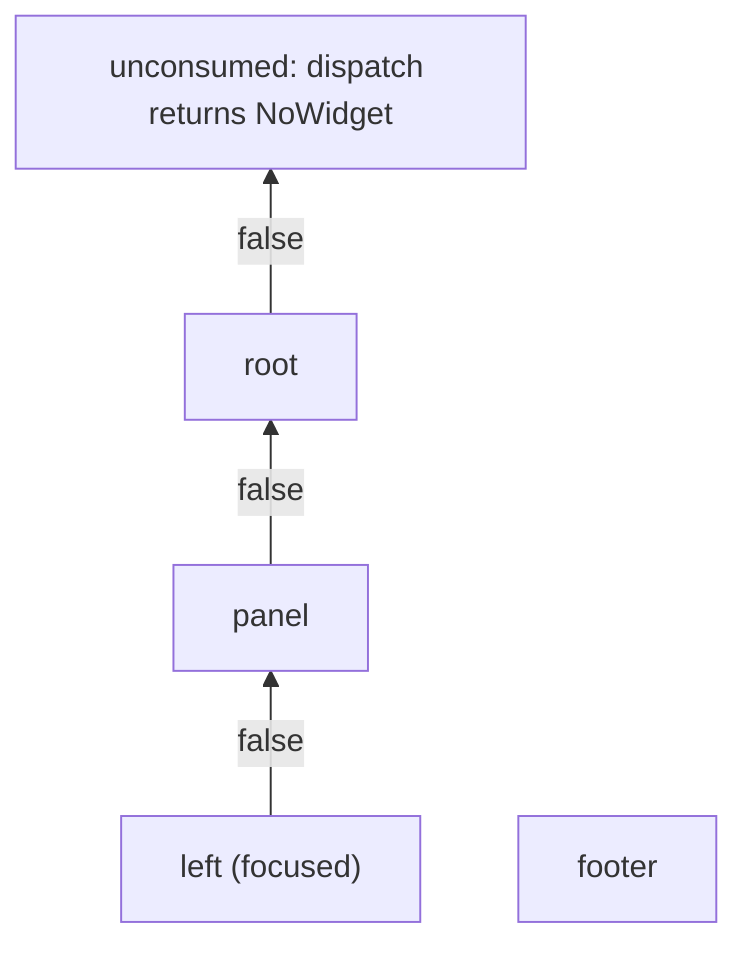

Everything a widget can react to arrives as an `Event`. One struct with a `kind` tag, rather than one type per kind, keeps every handler signature the same: you write one `handle_event` and branch on `kind`.

The payload fields reuse `std/term`'s own types, so key decoding is never reimplemented. Fields that do not apply to an event's kind keep their zero values.

## Event

```salam
pub struct Event:
    pub kind: int = 0
    pub key: term.Key = term.Key {}
    pub mouse: term.MouseEvent = term.MouseEvent {}
    pub width: int = 0
    pub height: int = 0
end
```

<ResponseField name="kind" type="int">One of the kind constants below.</ResponseField>
<ResponseField name="key" type="term.Key">The decoded key for `KeyEvent`, exactly as `term.ReadKey` returned it. For `MouseEvent`, `key.raw` keeps the raw escape sequence.</ResponseField>
<ResponseField name="mouse" type="term.MouseEvent">The decoded report for `MouseEvent`, from `term.DecodeMouse`. See [Mouse events](#mouse-events) for its fields and coordinates.</ResponseField>
<ResponseField name="width" type="int">The new terminal width in columns, for `ResizeEvent`.</ResponseField>
<ResponseField name="height" type="int">The new terminal height in rows, for `ResizeEvent`.</ResponseField>

## Kinds

| Constant | Value | Meaningful fields |
| --- | --- | --- |
| `NoEvent` | 0 | None. The zero value of `Event`. |
| `KeyEvent` | 1 | `key` |
| `MouseEvent` | 2 | `mouse`, `key.raw` |
| `ResizeEvent` | 3 | `width`, `height` |
| `TickEvent` | 4 | None. A periodic timer tick. |

## Mouse events

`mouse` is a `term.MouseEvent` from `term.DecodeMouse`:

| Field | Type | Meaning |
| --- | --- | --- |
| `col` | `int` | Column of the cursor, **1-based** as the terminal reports it. |
| `row` | `int` | Row of the cursor, **1-based**. |
| `button` | `int` | The button number from the report (`0` is the left button). |
| `pressed` | `bool` | `true` for a press, `false` for a release. |
| `motion` | `bool` | `true` when the report is cursor motion rather than a click. |
| `ok` | `bool` | `true` when the report decoded. When `false`, ignore the other fields. |

`col` and `row` are 1-based, but every coordinate in basalam is 0-based. Use `mouse_point()` instead of subtracting by hand:

```salam
pub func handle_event(event: basalam.Event): bool:
    if event.kind == basalam.MouseEvent and event.mouse.ok and event.mouse.pressed:
        p := event.mouse_point() // (0, 0) is the top-left cell
        this.clicked = p
        ret true
    end
    ret false
end
```

A mouse event does not go to the focused widget first. It starts at the widget under the cursor. See [Mouse routing](#mouse-routing).

## Helpers

Check `kind` before reading a payload field: the `key` of a tick or resize event is empty, not a key press. These methods do both checks in one call.

| Method | True when |
| --- | --- |
| `is_key(code: int): bool` | It is a `KeyEvent` and `key.code == code`, for example `event.is_key(term.KeyEnter)`. Modifiers are ignored. |
| `is_char(ch: str): bool` | It is a `KeyEvent` that typed exactly `ch` with neither Ctrl nor Alt held. `is_char("q")` does not match Ctrl+Q. |
| `mouse_point(): Point` | The cell a `MouseEvent` happened on, 0-based. Subtracts 1 from `mouse.col` and `mouse.row`. Only meaningful when `kind` is `MouseEvent` and `mouse.ok` is `true`. |
| `is_ctrl(ch: str): bool` | It is Ctrl plus the letter `ch`, for example `is_ctrl("c")`. In raw mode, Ctrl+C arrives as this key, not as a signal. |

```salam
pub func handle_event(event: basalam.Event): bool:
    if event.is_key(term.KeyEnter):
        this.presses += 1
        ret true
    end
    ret false
end
```

## Dispatch and bubbling

An event is offered to one widget first, normally the focused one. While it stays unconsumed, it bubbles to that widget's parent, then the grandparent, up to the root. The first `handle_event` that returns `true` stops it. Siblings and descendants never see it.



In this tree, a key pressed while `left` has focus visits `left`, `panel`, and `root`, in that order. `footer` is a sibling branch and is never asked. This lets a container handle keys its children ignore without the children knowing about it.

The [widget tree](/reference/tree) implements the walk with `Tree.dispatch`.

Once the walk reaches the root unconsumed, `dispatch` offers a `KeyEvent` to the screen's opt-in [keymap](/reference/keymap) before returning `false`; other event kinds stop at the root.

### Mouse routing

The starting widget depends on the kind. Keys, ticks, and resizes start at the focused widget. A `MouseEvent` whose report decoded starts at the widget under the cursor, then bubbles up from there. If no widget is under the cursor, it starts at the focused widget like the rest.

In the tree above, a click on `left` visits `left`, `panel`, `root`, even while `footer` has the focus. A click on empty space inside the root visits only `root`. The focused widget is asked only when it is on the path from the clicked widget to the root, or when nothing was hit. See [`hit_test`](/reference/screen#hit-testing) for how the widget under the cursor is chosen.

## Building events in tests

`term.Decode` turns the bytes a terminal would send into a `term.Key`, so you can build realistic key events without a terminal:

```salam
func key(seq: str): basalam.Event:
    ret basalam.Event { kind = basalam.KeyEvent, key = term.Decode(seq) }
end

up := key("\x1b[A") // key.code == term.KeyUp
plus := key("+") // key.code == term.KeyChar, key.ch == "+"
```
